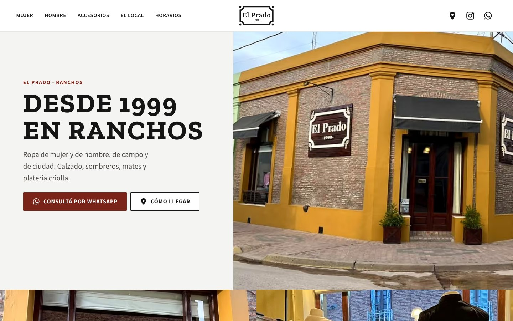
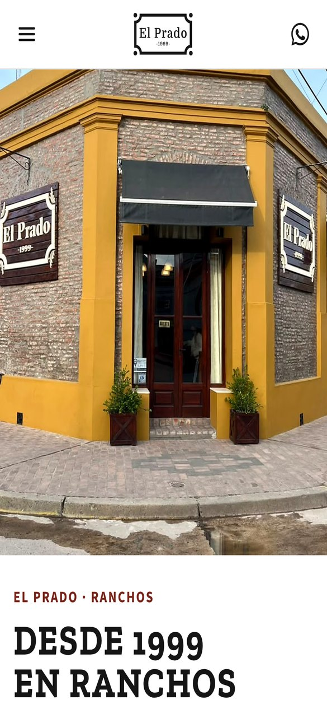
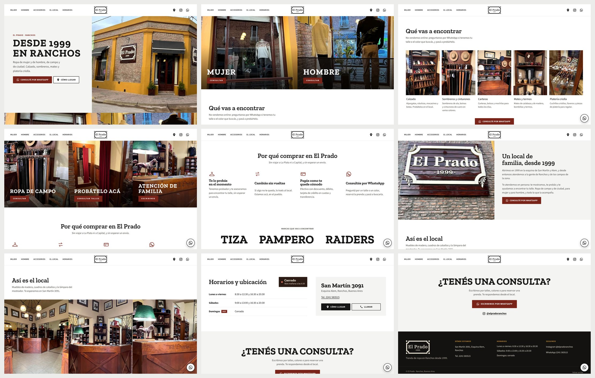
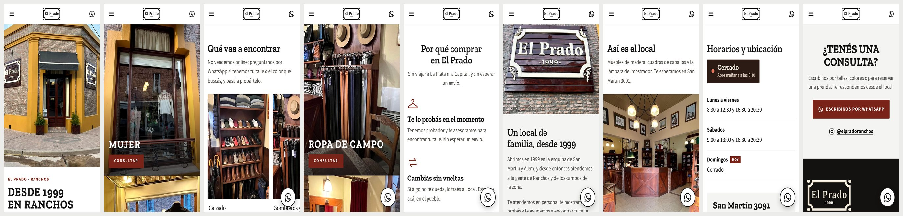

# El Prado · Sitio web

Sitio para **El Prado**, una tienda de ropa familiar de Ranchos (provincia de Buenos Aires) abierta desde 1999.
El objetivo es que la gente del pueblo y de los campos de la zona **escriba por WhatsApp o se acerque al local**.
No es una tienda online: no hay carrito ni precios, cada consulta va directo al WhatsApp del negocio.

**En línea:** [elpradoranchos.com](https://elpradoranchos.com)



<p align="center">
  
</p>

## Qué tiene

- **Consultas por WhatsApp con el mensaje ya escrito.** Cada rubro abre el chat con el tema cargado
  ("Hola! Vi la página de El Prado y quería consultar por calzado.").
- **Indicador "Abierto ahora / Cerrado"** calculado con la hora de Argentina. Muestra cuándo cierra o cuándo
  vuelve a abrir y resalta el día de hoy en la tabla de horarios. Se actualiza cada minuto (`lib/hours.ts`).
- **Pensado para el celular**, porque la mayoría del público entra desde ahí, e incluye adultos mayores: textos
  grandes, botones de 44 px o más, botón flotante de WhatsApp y menú lateral.
- **SEO local:** title y description, Open Graph con la fachada y datos estructurados de schema.org
  (`ClothingStore`) con dirección, teléfono, horarios, marcas e Instagram.
- **Imágenes optimizadas** con `next/image`: AVIF y WebP, tamaños responsive y prioridad en la imagen principal.
- **Scroll suave** con la rueda del mouse (Lenis). En el celular queda el scroll nativo y se respeta
  `prefers-reduced-motion`.
- **Accesibilidad:** foco visible, contraste AA, textos alternativos descriptivos, link para saltar al contenido
  y navegación completa con teclado.

## Resultados

Medido con Lighthouse (modo mobile) sobre el build de producción:

| Rendimiento | Accesibilidad | Buenas prácticas | SEO |
| :---: | :---: | :---: | :---: |
| 92–95 | 100 | 100 | 100 |

También probé que la página no se desplace de costado en celulares de 320 a 430 px de ancho, ni con el texto
del sistema al 200 %.

## Stack

- [Next.js 16](https://nextjs.org) (App Router) + React 19 + TypeScript
- Tailwind CSS 4 y CSS propio con variables (`app/globals.css`)
- `next/font` con Zilla Slab (títulos) y Source Sans 3 (texto)
- [Lenis](https://lenis.darkroom.engineering) para el scroll suave
- Desplegado en Vercel con dominio propio

## Estructura

```
app/
  layout.tsx          Metadata, fuentes, JSON-LD (schema.org) y script de apariciones
  page.tsx            Página principal
  globals.css         Tokens de color y tipografía, y estilos de cada sección
  dev/peor-caso/      Página de prueba con datos extremos (solo en desarrollo)
components/
  Landing.tsx         Todas las secciones de la página
  Hero.tsx            Portada con la fachada (vertical en celular, horizontal en desktop)
  Header.tsx          Cinta de anuncios, menú y menú mobile
  OpenSign.tsx        Indicador "Abierto ahora / Cerrado"
  SmoothScroll.tsx    Scroll suave y links internos
  WaFloat.tsx         Botón flotante de WhatsApp
lib/
  site.ts             Teléfono, WhatsApp, Instagram, dirección y link de Google Maps
  hours.ts            Horarios y cálculo de abierto o cerrado
  content.ts          Rubros y diferenciales del local
  fixtures.ts         Datos de prueba para /dev/peor-caso
assets/               Fotos originales del local, el video y el logo
media/hd/             Fotos procesadas para la web
instagram/            Foto de perfil, portadas de destacadas e historias para el Instagram del local
```

## Proceso

1. **Relevamiento:** fotos del local, datos del negocio, público (gente del pueblo, muchos adultos mayores, casi
   todos desde el celular) y objetivo (consultas por WhatsApp y visitas al local).
2. **Primera versión:** una dirección de arte "criolla" sobre madera oscura, con animación de entrada al local.
3. **Rediseño con feedback del cliente:** no le gustó, y tomamos como referencia el formato de tienda de
   Pampero: fondo blanco, fotos grandes a todo el ancho y botones rectos. Se sacó la animación y se reemplazaron
   los botones repetidos de cada producto por uno solo.
4. **Fotos:** las originales eran de baja resolución (720 px, enviadas por WhatsApp). Las reprocesé al doble de
   tamaño con remuestreo Lanczos, enfoque suave y un ajuste leve de contraste y color.
5. **Pruebas:** capturas en Chromium a 390×844 y 1440×900, casos extremos (textos largos, letra al 200 %,
   listas vacías) y Lighthouse en cada cambio.
6. **Publicación:** Vercel con el dominio `elpradoranchos.com`, y un perfil de Instagram ordenado con nombre,
   bio, enlaces y destacadas con el mismo estilo de la web.





## Cómo se hizo

Lo desarrollé con **asistencia de IA (Claude Code)**. Yo me encargué del relevamiento con el cliente, de
decidir la dirección de cada cambio, de revisar cada versión y de la publicación (Vercel, dominio, Google e
Instagram). El código lo generó la IA siguiendo esas decisiones, y lo revisé y probé en cada iteración.

## Correrlo localmente

Requiere Node.js 20.9 o superior.

```bash
npm install
npm run dev        # http://localhost:3000
```

Versión de producción:

```bash
npm run build
npm start
```

La página de prueba con datos extremos está en `http://localhost:3000/dev/peor-caso` (solo con `npm run dev`).

## Créditos

Las fotos, el logo y el contenido pertenecen a **El Prado** (Ranchos) y no pueden reutilizarse fuera de este
proyecto.
